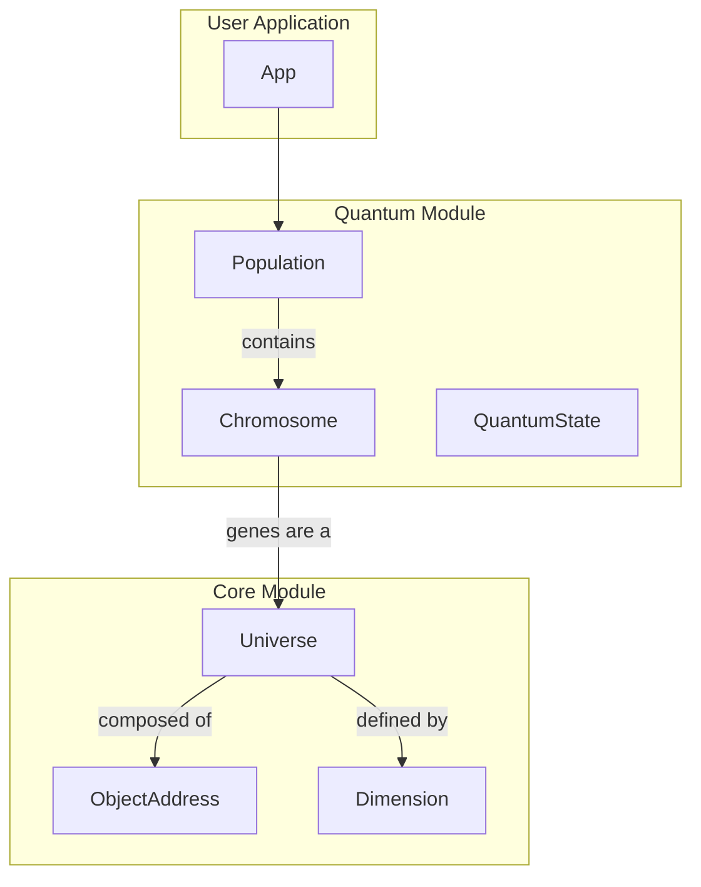

# Project Architecture Overview

This document provides a high-level overview of the project's architecture, explaining the roles of the `core` and `quantum` modules and how they interact.

## Core Concepts

The project is designed to explore the intersection of multi-dimensional data structures and quantum-inspired computing concepts. It's divided into two main modules:

*   **`core`**: Provides the foundational data structures for creating and managing multi-dimensional spaces, which are referred to as "universes."
*   **`quantum`**: Implements quantum-inspired data structures and a genetic algorithm that leverages the `core` module's "universe" concept.

## Module Interaction

The `quantum` module is built on top of the `core` module. The genetic algorithm in the `quantum` module uses the `Universe` data structure from the `core` module to represent the genes of a `Chromosome`. This creates a powerful and flexible system where the principles of quantum-inspired computing can be applied to the evolution of complex, multi-dimensional data structures.

## Mermaid.js Diagram: High-Level Architecture

This diagram illustrates the high-level architecture of the project, showing the relationship between the `core` and `quantum` modules.

## Detailed Interaction

1.  An application can use the `quantum` module to create a `Population` of `Chromosome`s for a genetic algorithm.
2.  Each `Chromosome` in the `Population` has a set of `genes`, which are represented by a `Universe` from the `core` module.
3.  This `Universe` is a multi-dimensional space, where each point (`ObjectAddress`) can hold a gene value.
4.  The genetic algorithm can then evolve the `Population`, performing operations like crossover and mutation on the `Chromosome`s' `Universe` of genes.
5.  The `QuantumState` concepts (e.g., `Superposition`) can be used to represent the genes, allowing for probabilistic and quantum-inspired approaches to genetic evolution.