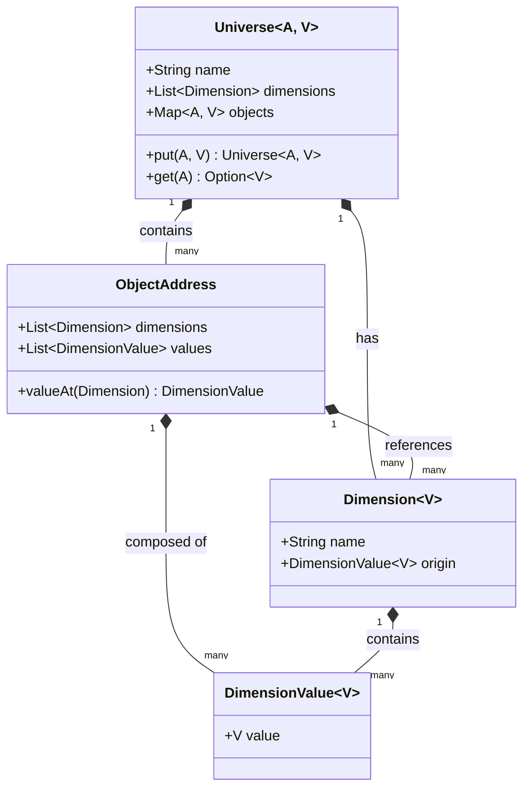

# Core Module Documentation

The `core` module provides the foundational data structures for creating and managing multi-dimensional spaces, referred to as "universes." The central concept is the `Universe`, which is a container for objects located at specific `ObjectAddress`es. These addresses are defined by their position along various `Dimension`s.

## Key Concepts

The `core` module is built around a few key traits:

*   **`Universe`**: Represents a multi-dimensional space containing objects. It's a map of `ObjectAddress`es to values.
*   **`ObjectAddress`**: Defines a specific point within a `Universe`. It's composed of a list of `DimensionValue`s.
*   **`Dimension`**: Represents an axis in the `Universe`. It defines the type of values that can exist along it.
*   **`DimensionValue`**: Represents a specific point on a `Dimension`.

## Mermaid.js Diagrams

### Class Diagram

This diagram illustrates the relationships between the main traits in the `core` module.



### Example Universe

This diagram shows an example of a 2-dimensional `Universe` with two objects.

```mermaid
graph TD
    subgraph MyUniverse
        direction LR
        A[Object A</br>Value: "Hello"]
        B[Object B</br>Value: "World"]
    end

    subgraph Dimensions
        direction TB
        subgraph X_Dimension [Dimension X]
            direction LR
            X1[Value: 1]
            X2[Value: 2]
        end
        subgraph Y_Dimension [Dimension Y]
            direction LR
            Y1[Value: 'a']
            Y2[Value: 'b']
        end
    end

    A -- Address -- AddressA(Address: [1, 'b'])
    B -- Address -- AddressB(Address: [2, 'a'])

    AddressA -- "Value at Dim X" --> X1
    AddressA -- "Value at Dim Y" --> Y2

    AddressB -- "Value at Dim X" --> X2
    AddressB -- "Value at Dim Y" --> Y1

```

## Detailed Breakdown

### `Universe[A <: ObjectAddress, V <: Comparable[_]]`

*   A generic trait that represents a multi-dimensional space.
*   It is parameterized by the type of `ObjectAddress` (`A`) and the type of value (`V`) it holds.
*   It contains a `name`, a list of `dimensions`, and a map of `objects` from `ObjectAddress` to `V`.
*   Provides methods for adding (`put`) and retrieving (`get`) objects.
*   Includes a method to `invertAddress` along a given dimension.

### `ObjectAddress`

*   Represents a unique location within a `Universe`.
*   It is composed of a list of `dimensions` and a corresponding list of `values` (`DimensionValue`).
*   Provides a `valueAt` method to get the `DimensionValue` for a specific `Dimension`.

### `Dimension[V <: Comparable[_]]`

*   Defines an axis of the `Universe`.
*   It has a `name` and an `origin` `DimensionValue`.
*   It can be either `Finite` or `Infinite`.
*   `Finite` dimensions have a defined set of `allValues`.
*   `DiscreteDimension` is a sub-trait for dimensions with discrete values, providing `next` and `previous` operations.

### `DimensionValue[V]`

*   Represents a specific point along a `Dimension`.
*   It wraps a `value` of a generic type `V`.
*   Provides methods for arithmetic operations like `plus` and `minus`.
*   `DiscreteDimensionValue` is a sub-trait for values on a `DiscreteDimension`, providing `next` and `previous` operations.