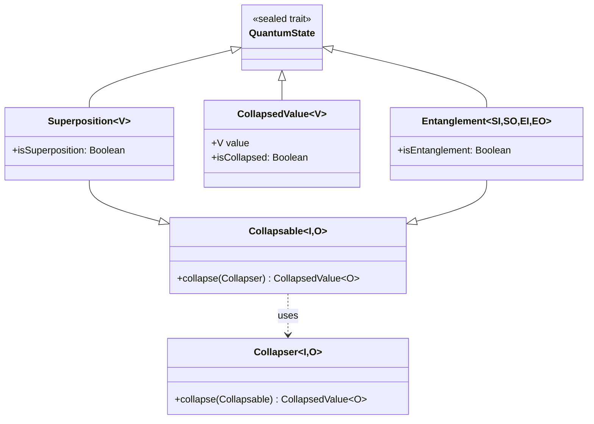
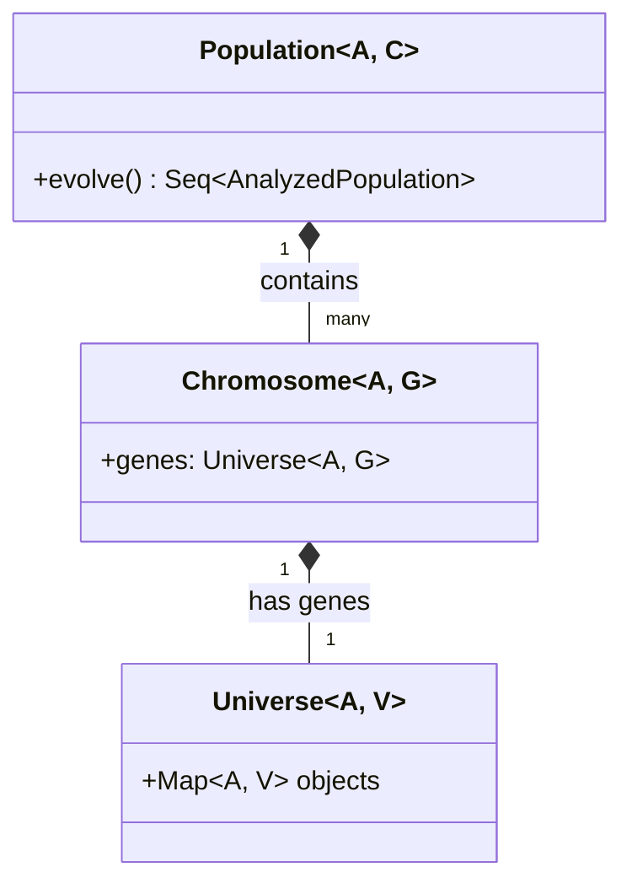
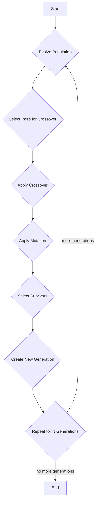

# Quantum Module Documentation

The `quantum` module provides a high-level, developer-friendly abstraction for quantum-inspired computing concepts. The core idea is to treat types as being in a superposition of all their possible values, which can then be "collapsed" into a single, definite state. This module also includes a genetic algorithm implementation that leverages these quantum-inspired concepts.

## Key Concepts

The `quantum` module is built around several key concepts:

*   **`QuantumState`**: A sealed trait that serves as the base for all quantum-inspired states.
*   **`Superposition`**: Represents a quantum state where a value has not yet been determined and exists as a combination of all possible states.
*   **`CollapsedValue`**: Represents a quantum state that has been "collapsed" into a single, definite value.
*   **`Entanglement`**: Represents a quantum state where multiple `Superposition`s are linked together.
*   **`Collapser`**: A trait responsible for collapsing a `Superposition` into a `CollapsedValue`. The module provides a `RandomFiniteSuperpositionCollapser` for this purpose.
*   **`Population` and `Chromosome`**: Traits that define a genetic algorithm, where a `Chromosome`'s genes are represented by a `Universe` from the `core` module.

## Mermaid.js Diagrams

### Quantum State Class Diagram

This diagram illustrates the relationships between the main traits for quantum states.

### Genetic Algorithm Class Diagram

This diagram shows the relationships between the genetic algorithm components and the `core` module's `Universe`.

### Genetic Algorithm Evolution Flow

This activity diagram illustrates the `evolve` process of the genetic algorithm.

## Detailed Breakdown

### Quantum-Inspired Data Structures

*   **`QuantumState`**: The base trait for all quantum-inspired states. It has `isSuperposition`, `isCollapsed`, and `isEntanglement` properties to identify the type of state.
*   **`Superposition[V]`**: Represents a value that is in a superposition of all possible states. It's a `Collapsable` type, meaning it can be collapsed into a `CollapsedValue`.
*   **`CollapsedValue[V]`**: Represents a value that has been collapsed from a `Superposition` into a single, concrete value.
*   **`Entanglement[SI, SO, EI, EO]`**: Represents a state where multiple `Collapsable` states are linked. When one state is collapsed, it can affect the outcome of the others.
*   **`Collapser[-I <: Collapsable[_, _], O]`**: A trait that defines the logic for collapsing a `Superposition`. The module provides `RandomFiniteSuperpositionCollapser` which randomly picks a value from a finite `Superposition`.

### Genetic Algorithm

*   **`Population[A <: ObjectAddress, C <: Chromosome[A, _]]`**: Represents a collection of `Chromosome`s. The `evolve` method drives the genetic algorithm's evolution process.
*   **`Chromosome[A <: ObjectAddress, G <: Comparable[_]]`**: Represents an individual in the population. Its genetic material (`genes`) is represented by a `Universe` object from the `core` module. This is a key integration point between the `quantum` and `core` modules.
*   **`Fitness`**: A trait for evaluating the fitness of a `Chromosome`. It can be either `IndividualFitness` (based on the chromosome itself) or `RelativeFitness` (based on the chromosome's performance relative to the population).
*   **`GenerationParameters`**: A class that holds the parameters for a generation, including the `fitness` function, `pairSelection` strategy, `crossover` operation, `mutagen`, and `survivorSelection` strategy.